# YYC³ 项目状态速览（一图看懂）

> 更新于 2026-10-29　|　用途：记不起来项目状态时，打开这页 30 秒找回全貌
> 详细论证见《[YYC3-AI-PAI-深度审核总结与建议-20261029](./YYC3-AI-PAI-深度审核总结与建议-20261029.md)》
> 🖼 图形版（深色视觉：产品实拍截图墙 + Python 平台健康速查 + 功能对照）：《[YYC3-项目关系地图.html](./YYC3-项目关系地图.html)》——浏览器直接打开

---

## 30 秒回忆版（三句话）

1. **这是同一个项目**（`@yyc3/ai-pai`，YYC³ AI-PAI 智能编程助手），只是活在三个地方；
2. **React 主线没死**——它在远程 `archive/2026-06-four-feature-snapshot` 分支上活跃维护（今天还在合 music 曲库 PR），本地是它 6-12 的旧快照；
3. **远程 main 已换道**成 Python 平台（YYC3-Pai），它占着 `pai.yyc3.vip` 只发一张品牌落地页，本项目的 Pages 部署从未上线过。

---

## 一张图：三条线的关系

```mermaid
flowchart TD
    subgraph 共同起点
    A["85749bcf<br/>共同祖先 2026-06-12"]
    end

    A -->|"本地走出 9 个提交后停更"| B["🟡 本地工作树<br/>main @ 80d2fa5<br/>停更于 06-12<br/>◀ 你在这里"]

    A -->|"远程走出 8 个提交<br/>持续维护"| C["🟢 React 主线（活跃）<br/>archive/2026-06-four-feature-snapshot<br/>@ a9aeedcc · 10-29 还在合并 PR<br/>新增：AI-Family素材 / NAS曲库 / 公网曲库端点<br/>+ pnpm overrides 修复"]

    O["octop 项目（外部）"] ==>|"10-10 硬分叉 + 品牌重塑"| D

    subgraph D["🔴 远程 main（换道产品）"]
    D1["Python 平台 YYC3-Pai<br/>langgraph / MCP / A2A<br/>@ e79e5e4f"]
    D2["dashboard/ = antd 全新前端<br/>（另起炉灶，非本项目代码）"]
    D1 --- D2
    end

    D1 -.->|"10-10 合并本项目全部历史作血脉<br/>（领先 689 提交，工作树已替换）"| A

    C -.->|"PR #19 开放中<br/>（archive 合回 main）"| D1

    D1 -->|"pages.yml 只发 public/"| E["🌐 pai.yyc3.vip<br/>2KB 品牌落地页（不是应用）"]

    B -.->|"旧仓库 YYC3-PAI 已删，remote 已修复<br/>（10-29）"| C

    style B fill:#3a3320,stroke:#c9a227
    style C fill:#1d3a24,stroke:#3fae5a
    style D fill:#3a1d1d,stroke:#c0504d
    style E fill:#22252b,stroke:#666
```



> 图例：🟢 活跃主线　🟡 停更快照　🔴 换道产品　虚线 = 血脉/待办关系

---

## 状态卡：五秒定位每条线

| | 🟡 本地工作树 | 🟢 React 主线（archive 分支） | 🔴 远程 main（Python 平台） |
|---|---|---|---|
| **在哪** | 本目录 main @ `80d2fa5` | 远程 `archive/2026-06-four-feature-snapshot` @ `a9aeedcc` | 远程 main @ `e79e5e4f` |
| **是什么** | 6-12 的旧快照 | 本项目的家，10-28/29 还在合 PR（曲库远程化、AI-Family 素材） | 换道的 Python 平台，只是合并了本项目历史 |
| **活跃吗** | ❌ 停更 4 个多月 | ✅ 活跃 | ✅ 活跃（但不是本项目） |
| **多/少什么** | 比 archive 少 8 提交；多 9 个本地提交（mp3 清理半途） | 最完整：含 pnpm overrides 修复 + 彻底的 mp3 清理 | 有 langgraph 后端 + antd dashboard；没有本项目 ImageGen/music |
| **下一步** | 合流到 archive 主线 | 一切开发与 Pages 部署的基座 | 只关注：漏洞修复 + 别让它占着 pai.yyc3.vip |

---

## 随时自查（复制即用）

```bash
git fetch origin

# 三条线各自最新位置
git log --oneline -1 HEAD                                        # 本地
git log --oneline -1 origin/archive/2026-06-four-feature-snapshot # React 主线
git log --oneline -1 origin/main                                  # Python 平台

# 本地与 React 主线差多少（ahead=本地独有 / behind=主线领先）
gh api "repos/YYC-Cube/YYC3-PAI-AI/compare/80d2fa5...archive%2F2026-06-four-feature-snapshot" \
  --jq '{ahead_by, behind_by, status}'

# 线上站点现在发的是什么
curl -s https://pai.yyc3.vip/ | head -20

# 远程仓库还有多少未修漏洞
gh api "repos/YYC-Cube/YYC3-PAI-AI/dependabot/alerts?state=open" --jq 'length'
```

---

## FAQ（最容易懵的三个问题）

**Q1：为什么找不到 `YYC3-PAI` 仓库了？**
旧仓库 2026-10-15 已被删除（非改名、无重定向）。一切内容都在 `YYC-Cube/YYC3-PAI-AI` 里。本地 remote 已于 10-29 修复指向新址。

**Q2：为什么切到远程 main 后完全不是这个项目？**
main 已换道为 Python 平台（工作树整体替换），本项目代码只在 `archive/2026-06-four-feature-snapshot` 分支上（以及 main 的历史里）。**别在 main 上找本项目，也千万别把本地 React 代码往 main 上推。**

**Q3：pai.yyc3.vip 为什么是个落地页？**
Pages 归 Python 平台仓库管，它的 `pages.yml` 只发布 `public/` 里的静态品牌页。把应用发上去的方案见主报告第 4 章（推荐：pages.yml 改为 checkout archive 主线构建发布）。
